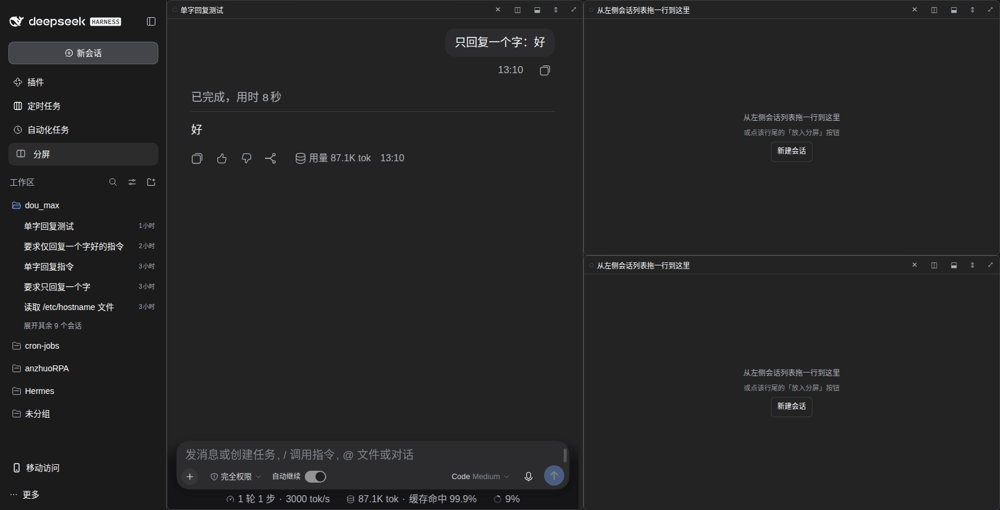
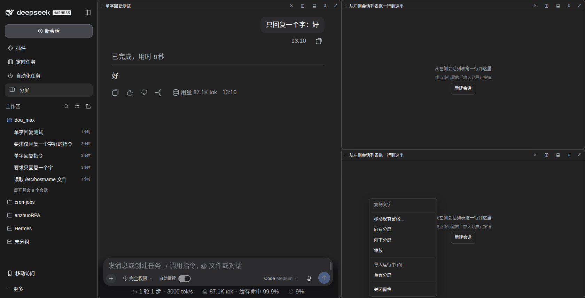

# dsh-web-split

[**中文**](README.md) | [English](README.en.md)

**给 DeepSeek Harness Web 加一个自由分屏**——开一个分屏视图放在旁边，同时盯住两个、三个甚至四个会话；每个窗格渲染的是那个会话**真正的对话**，连输入框都能直接用。



## 功能

- **侧栏入口**：侧栏里的「分屏」按钮把分屏视图作为一个主面板打开。
- **自由布局**：向右/向下分屏；把一个窗格拖到另一个窗格上＝交换；拖到窗格边缘＝把窗格挪过去；拖分隔线改比例；**双击分隔线**横竖翻转并回到 50/50。
- **从各处填充窗格**：从左侧会话列表把一行拖进窗格、点行尾的「放入分屏窗格」按钮，或者用窗格右键菜单。
- **真对话**：每个窗格挂载官方的 `conversation.content` 槽位，流式输出、工具调用、附件、输入框的行为与正常视图完全一致。
- **未读点同步**：侧栏的未读指示同步到窗格标题上，一眼看出哪个窗格在说话。
- **导入运行中会话**：一次把正在跑的会话按窗格上限排进分屏，不会关闭任何会话。**定时任务工作区的会话会被跳过**（cwd 最后一段是 `cron-jobs`；`client.js` 里的 `SCHEDULED_WORKSPACE` 可改）。
- **布局持久化**：整棵窗格树（分栏、比例、分配）存在 `localStorage`，刷新后恢复。
- **中英双语界面**：插件自带中文与英文文案。
- **宿主侧零行为**：宿主那一半只负责声明客户端 bundle，不碰 Session 域。



## 安装

插件是一个带 loader patch（`cordis.patch.yml`）的 bundle，和普通 DSH 插件一样安装：

```bash
# 预构建包（推荐，免 allowBuilds 构建授权）
dsh plugin --profile web add https://github.com/yuloop/dsh-web-split/releases/latest/download/dsh-web-split.tgz

# 直接从 GitHub 源码装
dsh plugin --profile web add github:yuloop/dsh-web-split

# 或者从本地目录装
dsh plugin --profile web add /path/to/dsh-web-split
```

装完**重启 DSH**，然后刷新页面，侧栏就会出现「分屏」入口。

> `cordis.patch.yml` 用包名 `dsh-web-split` 指向 `index.js`。如果你是手工把文件拷进本地插件目录（而不是用安装器），把 patch 里的 `name` 改成 `index.js` 的绝对路径——开发机上就是这么跑的。

## 已知限制（重要）

在**窗格里点击文件链接或图片**会弹错误框：

```
无法打开文件 / sidebarRight: no session surface is mounted
```

原因：文件链接是通过右侧栏的 `sidebarRight.require()` 打开的，而它只认「当前显示在会话列上的那个会话」。全局的 `main` 面板不带会话上下文，所以这个调用会抛错。窗格本身照常渲染、滚动、输入；**只有文件/图片预览受影响**——想看文件就点侧栏那个会话回到普通视图，再点链接。

这条限制也正是本版本采用「面板式」的原因：还有一个「浮层式」变体（把网格浮在会话列上，让右侧栏继续工作），它换掉了网格所在的位置，发布时还不稳定，因此**不包含在 1.0.0 里**。

## 环境要求

- DeepSeek Harness Web，且带官方 UI 包（`dsh-client-ui-layout`、`-session`、`-conversation`、`dsh-client-locale`、`dsh-api-session-controller`）。
- 开发与验证用的是 DSH `0.1.1-rc.2`。

## 目录结构

```
client.js          Web 端全部实现（面板、窗格树、拖放、i18n、CSS）
index.js           宿主侧：只声明 bundle，不注册别的
cordis.patch.yml   loader patch 片段（insert id: web-split）
package.json       manifest，含 dsh.client 声明
docs/DEVLOG.md     开发日志，逐日记录（中文）
screenshots/       README 用的截图
```

## 许可

MIT，见 [LICENSE](LICENSE)。
